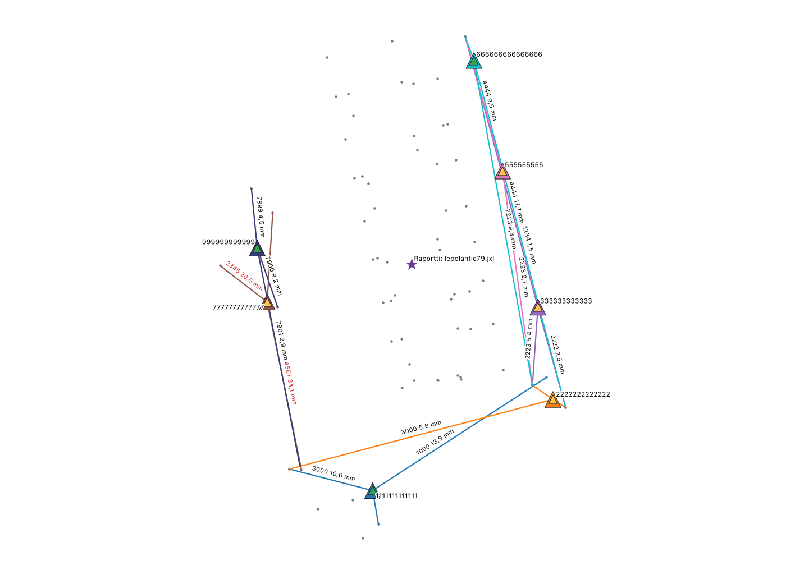
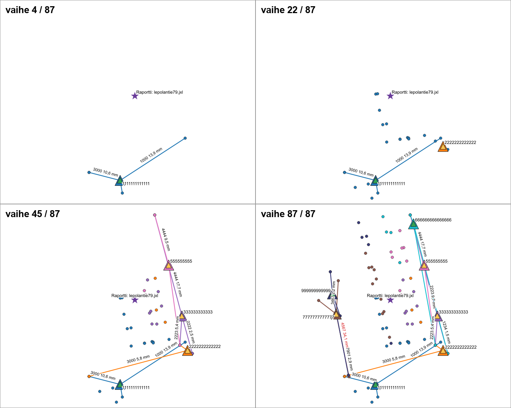

# Maastomittauksen apuri

Streamlit-sovellus, jolla:

- haetaan kiinteistön lähellä olevat **kiintopisteet**, **rajamerkit** ja **kiinteistörajat** Maanmittauslaitoksen avoimista rajapinnoista (koko Suomi),
- haetaan Helsingissä kiinteistön **rakennusten nurkkapisteet** Helsingin kantakartasta,
- tuodaan **omia kiintopisteitä** tekstitiedostosta (esim. Helsingin kaupungin omat kiintopisteet),
- tallennetaan ne **PostgreSQL/PostGIS**-kantaan, josta ne näkyvät **QGIS**:ssä,
- luetaan Trimblen **JobXML**-tiedostoja (.jxl/.xml), tehdään niistä mittausraportti (PDF) ja tallennetaan mitatut pisteet kantaan,
- piirretään mitatuista talon kulmapisteistä **seinälinja**, jonka voi ladata **DXF**-tiedostona,
- ladataan JobXML:n pisteet ja kiinteistöhaun pisteet **krd**-tiedostona (esim. MicroStationiin).

Kaikki koordinaatit ovat ETRS-GK25-koordinaatistossa (**EPSG:3879**).

## Tiedostot

| Tiedosto | Sisältö |
|---|---|
| `app.py` | Streamlit-käyttöliittymä (salasanasuoja, kiinteistöhaku, omien kiintopisteiden tuonti, JobXML-tuonti, poistot) |
| `hae_kiintopisteet.py` | MML-rajapintahaut, kiintopisteiden lataus, osoitehaku, rakennusten nurkat (Helsingin WFS), omien kiintopisteiden jäsennys, kartat ja kantaan tallennus. Toimii myös komentoriviltä |
| `jobxml_tuonti.py` | JobXML-jäsennys, kahden kojeasennon käsittely, asemapisteiden laatu, krd-vienti |
| `mittausraportti.py` | Mittausraportti PDF:nä (korvaa Trimble Accessin mittausraportin) |
| `seinalinja.py` | Seinälinjan muodostus pistekoodeista ja DXF-vienti |
| `qgis_plugin/` | QGIS-lisäosa: seinälinja JXL-tiedostosta (ks. QGIS-lisäosa) |
| `schema.sql` | Tietokannan taulut ja `kiintopisteet_saateella()`-funktio |
| `tests/` | Testit (pytest) |
| `kuvat/` | Sovelluksen kuvat |
| `.devcontainer/` | GitHub Codespaces -ympäristö |

## Vaatimukset

- Python 3.11
- PostgreSQL + PostGIS
- GDAL (`ogr2ogr`), ks. `packages.txt`
- Maanmittauslaitoksen API-avain (avoimet rajapinnat)
- Python-paketit: `pip install -r requirements.txt`

## Asetukset

Sovellus lukee nämä arvot Streamlitin salaisuuksista (`.streamlit/secrets.toml`) tai ympäristömuuttujista:

```toml
MML_API_KEY = "..."
PGHOST = "..."
PGPORT = "5432"
PGDATABASE = "..."
PGUSER = "..."
PGPASSWORD = "..."
SOVELLUKSEN_SALASANA = "..."
POISTON_SALASANA = "..."
```

`SOVELLUKSEN_SALASANA` päästää sovellukseen. `POISTON_SALASANA` on erillinen salasana tietojen poistoon kannasta (mittaukset, seinälinjat, raportit ja omat kiintopisteet); se kysytään kerran istunnossa. Ilman sitä poistot eivät ole käytössä. Salasana suojaa vain sovelluksen poistonapit: kannan tunnuksilla (esim. QGIS) voi edelleen poistaa suoraan.

Älä vie `secrets.toml`-tiedostoa versionhallintaan.

## Tietokanta

Aja skeema kerran:

```bash
psql -d <tietokanta> -f schema.sql
```

Skeeman voi ajaa uudelleen olemassa olevaan kantaan: se luo vain puuttuvat taulut eikä koske tallennettuihin tietoihin.

Taulut (kaikki EPSG:3879):

| Taulu | Sisältö |
|---|---|
| `kiintopisteet` | MML:n ja omat kiintopisteet |
| `kiinteistot` | Haettujen kiinteistöjen keskipisteet |
| `haku_tulokset` | Viimeisimmän haun kiintopisteet säteen sisällä (tyhjennetään joka haulla) |
| `rajamerkit`, `kiinteistorajat` | Haetun kiinteistön rajamerkit ja rajaviivat |
| `kentalla_mitatut_pisteet` | JobXML-mittausten pisteet (kertyvät tallennuksista); `mitattu` = mittausaika, `asema`/`asema_nro` = asema, jolta piste mitattiin, `jarjestys` = mittausjärjestys (ks. Mittauksen animaatio) |
| `seinalinjat` | Mittauksista muodostetut seinälinjat; saman kiinteistön ja tiedoston viivat korvataan uudelleentallennuksessa |
| `mittausraportit` | Mittausraportin yhteenveto (päivä, kalusto, huonoin asema, tarkistettavat kohdat) ja PDF; piste mitattujen pisteiden keskellä |
| `asemapisteet` | Kojeasemat laatuluokkineen, residuaaleineen ja keskivirheineen (mm); `liitospisteet` = orientoinnin liitospisteet ja niiden vaakaresiduaalit |
| `asemien_liitokset` | Viiva asemalta jokaiseen liitospisteeseen ja korkeusliitokseen residuaaleineen (mm) |

*Tallenna mittaukset kantaan* vie pisteet, mittausraportin, asemapisteet ja Seinälinja-osiossa näkyvän seinälinjan (valittu järjestys, kantakartta- ja LiDAR-valinnat) samalla kertaa. Saman kiinteistön ja tiedoston pisteet, raportti, asemat ja seinälinja korvataan uudelleentallennuksessa (ei tuplia). Jos sama tiedosto on tallennettu aiemmin toiselle kiinteistölle (esim. ensin väärällä tunnuksella), tallennus huomauttaa siitä; vanhat rivit poistetaan Ylläpito-välilehdellä. Tallennetut raportit haetaan ja PDF:t ladataan välilehdeltä *Tallennetut mittausraportit*.

### QGIS-tyylit

`qgis_tyylit/tyylit_kantaan.sql` tallentaa kannan `layer_styles`-tauluun oletustyylit, jotka QGIS ottaa käyttöön, kun taso lisätään kannasta (aja kerran, esim. Supabasen SQL Editorissa). Jo lisättyyn tasoon: *Layer Properties → Style → Load Style* (kannasta tai `qgis_tyylit/<taulu>.qml`).

- `asemapisteet`: kolmio laatuluokan värillä (Erinomainen tummanvihreä, Hyvä vihreä, Tyydyttävä keltainen, Heikko oranssinpunainen, Huono punainen) ja reunus aseman omalla värillä, nimiönä aseman nimi
- `asemien_liitokset`: viiva asemalta liitospisteeseen aseman omalla värillä (sama kuin asemapisteen reunus; korkeusliitos katkoviivana), nimiönä liitospiste ja dHz, yli 20 mm punaisella. Aseman väri tulee järjestysnumerosta `asema_nro` kymmenen värin paletista.
- `mittausraportit`: violetti tähti, nimiönä lähdetiedosto
- `kentalla_mitatut_pisteet`: ympyrä aseman värillä (asemattomat GNSS-pisteet harmaina), pistetunnus näkyy mittakaavassa 1:500 ja tarkemmin



### Mittauksen animaatio

Asemapisteet, liitosviivat ja mitatut pisteet voi toistaa QGIS:n aikasäätimellä (Temporal Controller) siinä järjestyksessä kuin ne mitattiin: ensin asema, sitten liitosviivat sitä mukaa kuin liitospisteet mitataan, sitten aseman mittaamat pisteet, sitten seuraava asema. Tahti on tasainen (yksi vaihe sekunnissa animaatioaikaa) eikä oikea mittausaika, joten tauot eivät näy. Järjestys (`jarjestys`) lasketaan tallennuksessa, ja kanta laskee siitä sarakkeen `animaatioaika` (1.1.2000 00:00 UTC + jarjestys sekuntia), josta tyylit lukevat ajan. Sarake on aikavyöhykkeellinen, koska aikasäädin toimii UTC-ajassa.

1. Lisää tasot `asemapisteet`, `asemien_liitokset` ja `kentalla_mitatut_pisteet` kannasta.
2. Lataa kullekin tyyli erikseen: tason ominaisuudet → *Tyyli → Lataa tyyli → Tietokannasta* (tai `qgis_tyylit/<taulu>.qml`). QGIS ei ota aika-asetuksia mukaan, kun se käyttää kannan oletustyyliä tason lisäyksessä, mutta erikseen ladattuna ne tulevat.
3. *Näytä → Paneelit → Aikasäädin* (kellokuvake) → *Animoitu aikanavigointi* (kello ja ▶) → *Aseta koko aikaväli* (pyöreä nuoli Animation range -rivin lopussa) → askel **1 sekunti** → ▶. Nopeus: asetuksista (ratas) kuvataajuus, esim. 5 ruutua sekunnissa.
4. Useamman tiedoston mittaukset alkavat samaan aikaan; suodata tasot tarvittaessa lähdetiedostolla (`"lahdetiedosto" = 'työ.jxl'`). Animaation saa videoksi tai kuvasarjaksi aikasäätimen *Vie animaatio* -toiminnolla.
5. Video: helpoin on macOS:n näytön tallennus (Cmd+Shift+5 → *Tallenna valittu osa* → rajaa kartta → ▶ aikasäätimessä). Toinen tapa: aikasäätimen *Vie animaatio* (levykekuvake Step-rivin lopussa) tallentaa jokaisen vaiheen PNG-kuvaksi (esim. `ruutu####.png`), ja kuvat yhdistetään videoksi esim. ffmpegillä: `ffmpeg -framerate 5 -i ruutu%04d.png -c:v libx264 -pix_fmt yuv420p animaatio.mp4`.

Vain muutoksen jälkeen tallennetuilla mittauksilla on järjestys; vanhat rivit näkyvät koko animaation ajan.



Tyylit tehdään skriptillä `qgis_tyylit/tee_tyylit.py` QGIS:n Pythonilla (ohje skriptin alussa). Seinälinjan kaaret tallennetaan tihennettynä murtoviivana. Jos LiDAR-DXF oli mukana, viivalle tallennetaan myös poikkeama LiDAR-seinistä (`lidar_keskiarvo_cm`, `lidar_suurin_cm`, `lidar_peitto_pros`). Ylläpito-välilehden poisto poistaa pisteet ja seinälinjat yhdessä.

## Käynnistys

**Codespaces:** avaa repo Codespacesissa. Devcontainer asentaa riippuvuudet ja käynnistää sovelluksen portissa 8501.

**Paikallisesti:**

```bash
pip install -r requirements.txt
streamlit run app.py
```

Sovelluksessa on neljä välilehteä: **Kiinteistöhaku** (kiintopisteet, rajamerkit, rajaviivat ja rakennusten nurkat), **Mittausten tuonti (JobXML)** (raportti, seinälinja, lataukset ja tallennus kantaan), **Tallennetut mittausraportit** ja **Ylläpito** (omien kiintopisteiden tuonti ja poistot kannasta). Kaikki välilehdet pysyvät tallessa välilehteä vaihdettaessa, esim. ladattu JobXML ja seinälinjan muokkaukset.

**Komentorivi (kiintopistehaku ilman käyttöliittymää):**

```bash
export MML_API_KEY="oma-api-avaimesi"
python3 hae_kiintopisteet.py --kiinteistotunnus 091-25-840-8 \
    --sade 1000 --kiinteistorajat \
    --tulostiedosto kiintopisteet.krd --kartta-tiedosto kartta.png
```

## Kiintopisteet

Kiintopisteet haetaan kannan `kiintopisteet`-taulusta.

**Helsingissä** (kiinteistötunnus alkaa 091) käytetään vain tuotuja Helsingin kaupungin kiintopisteitä (ks. Omat kiintopisteet). MML:n pisteitä ei näytetä eikä ladata. Jos kaupungin pisteitä ei ole kannassa hakualueella, sovellus kehottaa tuomaan ne.

**Muualla** kiintopisteet tulevat MML:ltä: jos hakualueella ei ole kannassa yhtään kiintopistettä, sovellus lataa ne Maanmittauslaitoksen tiedostopalvelusta kiinteistön ympäriltä (hakusäde + 10 %) ja tallentaa kantaan. Lataus kestää yleensä alle minuutin. Valinnalla **Päivitä kiintopisteet MML:ltä** pisteet ladataan uudelleen, vaikka niitä olisi jo kannassa.

Uudet pisteet lisätään kantaan, ja samannimiset pisteet korvataan. Muiden alueiden pisteet säilyvät. Sama koskee komentorivin `--lataa-kiintopisteet`-valintaa (Helsingin alue). Lataus vaatii GDAL:n (`ogr2ogr`).

## Omat kiintopisteet (txt)

Kiintopisteet, joita ei ole avoimissa rajapinnoissa (esim. Helsingin kaupungin omat kiintopisteet), voi tuoda teksti- tai krd-tiedostosta Ylläpito-välilehdellä kohdassa **Tuo omat kiintopisteet (txt/krd, ETRS-GK25)**. Ne tallennetaan `kiintopisteet`-tauluun luokalla `Helsinki (oma tiedosto)`. Helsingin kiinteistöillä haku käyttää vain näitä pisteitä, muualla ne näkyvät MML:n pisteiden rinnalla.

- N (6,6–7,8 milj.) ja E (25–26 milj.) tunnistetaan suuruusluokasta, joten sarakkeiden järjestys ei haittaa. Korkeus on koordinaattien jälkeinen luku (itseisarvo alle 1000), ja se voi puuttua.
- Pistetunnus on ensimmäinen sarake (`nimi N E Z`, `nimi koodi N E Z`). Jos ennen koordinaatteja on vähintään kolme saraketta, kuten krd-muodossa `1 0 koodi numero E N Z`, tunnus on koordinaatteja edeltävä sarake ja koodi sitä edeltävä. Koodi näkyy esikatselussa, mutta sitä ei tallenneta.
- Jos sama tunnus esiintyy tiedostossa useammin kuin kerran, esikatselu varoittaa, koska tallennuksessa jää vain viimeinen.
- Erottimeksi käy välilyönti, sarkain, puolipiste tai pilkku. Desimaalipilkku käy, kun erotin ei ole pilkku.
- Rivit, joilta ei löydy koordinaatteja (otsikot, kommentit), ohitetaan ja näytetään esikatselussa.
- Samanniminen piste korvataan. Omia pisteitä ei suodateta varamerkkeinä, ja ne näytetään koko tunnuksella. MML-lataus ei poista niitä, ja ne voi poistaa omalla painikkeellaan.

> **Huom:** Streamlit Cloudin kanta on ulkoisella palvelimella. Tarkista, saako aineiston tallentaa sinne.

## Rakennusten nurkkapisteet (Helsinki)

Helsingissä haku poimii myös kiinteistön rakennusten nurkkapisteet Helsingin kantakartasta (WFS-taso `avoindata:Rakennukset_alue`, ei API-avainta). Mukaan tulevat voimassa olevat rakennukset, joiden pinta-alasta vähintään puolet on kiinteistön alueella. Naapurin rakennus, joka ulottuu rajan yli, jää siis pois.

- Nurkat ovat rakennuksen ääriviivan kärkipisteet, myös sisäpihojen. Suoralla seinällä olevat välipisteet (alle 1 cm suorasta) jätetään pois.
- Nurkat numeroidaan juoksevasti 1, 2, … kaikkien kiinteistön rakennusten yli (rakennus 1 on kiinteistön suurin).
- Nurkat näkyvät kartalla omana tasonaan ja sovelluksessa taulukkona (alasvetovalikko "Rakennusten nurkat"). Ne kirjoitetaan `kiintopisteet.krd`:hen koodilla `4` (ks. krd-tiedostot).

> **Huom:** Tarkista kantakartan rakennusten tarkkuus, ja kuvaako ääriviiva seinää vai räystästä, ennen kuin käytät pisteitä mittauksen pohjana.

## Kartat

Sekä kiintopiste- ja rajamerkkihaun kartta että JobXML-osion kokonaiskartta ovat zoomattavia (Leaflet/folium). Taustakartan voi vaihtaa kartan oikeasta yläkulmasta:

| Taustakartta | Huom |
|---|---|
| Helsingin kantakartta, myös harmaana | WMS. Oletus Helsingissä. |
| MML taustakartta | WMTS, vaatii `MML_API_KEY`:n. Oletus Helsingin ulkopuolella. |
| MML maastokartta ja MML ortokuva (ilmakuva) | WMTS, vaatii `MML_API_KEY`:n |
| OpenStreetMap | Oletus, jos MML-avainta ei ole |

Hakukartalla näkyvät kiinteistön keskipiste, kiintopisteet, rajamerkit, kiinteistörajat (pituus näkyy, kun vie hiiren viivan päälle), hakusäde sekä Helsingissä rakennusten ääriviivat ja nurkat. JobXML-kartalla pisteet näkyvät kategorioittain, esim. asemapisteet keltaisina tähtinä ja korkeusliitokset harmaina kolmioina. Myös seinälinja näkyy, jos se on muodostettu. Jokainen kohde on oma tasonsa, ja tason symboli näkyy tasovalitsimessa. Pistettä klikkaamalla näkyvät sen tiedot. Kartat saa edelleen myös PNG-kuvina.

> **Huom:** MML-karttatiilet haetaan suoraan selaimessa, joten MML:n API-avain näkyy sivun lähdekoodissa sovelluksen käyttäjille.

## Mittausraportti (PDF)

JobXML-osion kohdassa **Lataukset** on nappi "Lataa mittausraportti (PDF)". Raportti tehdään kerran tiedostoa kohden (asemien kartat haetaan Helsingin WMS:stä), ja nappi lataa sen suoraan. Raportissa on samat tiedot kuin Trimble Accessin mittausraportissa, mutta tiiviimmin:

- **Perustiedot:** työ, tiedosto, ohjelmaversio, ohjaimen sarjanumero, mittauspäivä ja työaika, koodikirjasto, koordinaatisto ja geoidimalli.
- **Kalusto** kerran: takymetri (malli, sarjanumero, tarkkuudet), GNSS-vastaanotin ja antennikorkeudet, tähykset ja prismavakiot.
- **Koordinaatisto ja asetukset:** projektion ja ellipsoidin parametrit, datumimuunnos, korjaukset (etäisyydet, merenpintakorjaus, lähipistetasoitus), GNSS-maskit, ilmastokorjaukset ja takymetrin asetukset (taitekerroin, kollimaatiot, EDM-vakio).
- **Yhteenveto ja tarkistukset:** pisteiden määrät sekä huomiot: asemat, joiden laatuluokka on Tyydyttävä tai heikompi tai joilla on laatuvaroituksia, yli 30 mm korkeusresiduaalit (laatuluokka arvioi vain tasosijaintia), MML:n 2x-säännön ylitykset ja hylätyt pisteet.
- **Liitospisteet:** RTK-mittaukset tarkkuuksineen (vaaka- ja pystytarkkuus, PDOP/HDOP/VDOP, satelliitit) sekä lisätiedot: ECEF-koordinaatit, antennikorkeus, kallistusetäisyys, GDOP, tukiaseman tiedon ikä, käytetyt sijainnit ja kovarianssit (VCV).
- **Asemapisteet:** pieni kartta, määrittelytapa ja mittakaava, koordinaatit ja keskivirheet, kojekorkeus, ilmasto, orientointi, laatuluokka ja residuaalit liitospisteittäin (dN, dE, dH, dHA, dVA, dSD).
- **Mittaustapahtumat** aikajärjestyksessä: roverin käynnistys ja lopetus, VRS-yhteydet, RTK:n alustukset ja asemapisteiden määritykset.
- **Mitatut pisteet** (koordinaatit, koodi, asema, kaksi kojeasentoa) ja **hylätyt pisteet**.
- **Liite:** raakahavainnot asemittain (HA, VA, SD, tähyskorkeus, prismavakio, kojeasento, tähyksen lukitus).

Kulmat ovat työn kulmayksikössä (yleensä gon), etäisyydet metreinä ja residuaalit millimetreinä.

## krd-tiedostot

Kiinteistöhaun tulokset (kiintopisteet koodilla 11, rajamerkit 12, rakennusten nurkat 4) ja JobXML-tiedoston pisteet ladataan krd-muodossa:

```
       1       0     100    1000  25495795.048   6680659.379        30.945
```

Sarakkeet ovat `1 0 koodi numero E N Z`, leveydet 8+8+8+8+14+14+14 merkkiä oikealle tasattuina, 3 desimaalia (WGS84:llä 8) ja rivinvaihto CRLF. Puuttuva korkeus kirjoitetaan `0.000`. Yli 8 merkin nimen eteen tulee yksi välilyönti, joten sarakkeet siirtyvät; siitä varoitetaan.

**JobXML → krd** (kohta "Pisteet krd-tiedostona"):

- Mukaan tulevat liitospisteet ja mitatut pisteet (kartoitus- ja merkintäpisteet), kukin nimi kerran tiedoston järjestyksessä. Valinnoilla saa mukaan asemapisteet ja apupisteet (kartoituspisteenä mitatut, joita käytettiin myöhemmin liitospisteinä).
- Liitospisteen koordinaatti on alkuperäinen RTK-mittaus, jos se on, muuten ensimmäinen mittaus (kartoituspisteenä tai liitoshavaintona).
- krd:hen kirjoitetaan vain numerokoodi. Numerokoodista otetaan ensimmäinen osa (`9 1` → `9`) ja kirjainkoodista pistetyyppi (`RAK 5` → `5`, `RAK 8 2` → `8`).
- Pelkkä kirjainkoodi (esim. `RAK`, `LIP`, `SK`) muunnetaan numeroksi taulukolla, joka näkyy latauskohdassa, kun tiedostossa on kirjainkoodeja. Oletukset (`KRD_KOODIMUUNNOS`, `jobxml_tuonti.py`): RAK, KATOS ja LIP → `100`, muut (ASP, AITA ja ohjauskoodit SK, JV, AV, SV) → `9`. Taulukkoa voi muokata, ja muutokset säilyvät istunnon ajan. Tuntematon kirjainkoodi kirjoitetaan koodilla `9`, ja siitä tulee varoitus.

## Seinälinja ja DXF-vienti

Kun ladatussa JobXML-tiedostossa on vähintään yksi koodin **8** piste, sovellukseen ilmestyy osio **Seinälinja**. Viiva muodostetaan pistekoodeista:

| Koodi | Merkitys |
|---|---|
| `8` | Viivan alku ja loppu (myös kulma) |
| `5` | Talon kulma |
| `100` | Piste seinälinjalla, ei kulma (esim. kulma piilossa rännin takana) |
| `4` | Piste kaarella (esim. kaareva erkkeri tai pyöristetty kulma) |
| muut | Eivät vaikuta viivaan (esim. apupisteet koodilla 9) |

Asemapisteet, liitospisteet, korkeusliitokset ja liitospisteiden RTK-mittaukset eivät kuulu viivaan koskaan, vaikka niillä olisi seinälinjan koodi (esim. oletuskoodi 100).

Viivan muoto riippuu 8-pisteiden määrästä:

- **Yksi 8-piste:** koko talo on yksi suljettu viiva, joka alkaa ja päättyy tähän pisteeseen. Ennen 8-pistettä mitatut pisteet jätetään pois, ja niistä tulee varoitus. Riittää, että 8-piste on talon ainoa näkyvä kulma: muut kulmat voidaan laskea 100-pisteistä.
- **Kaksi 8-pistettä:** avoin viiva ensimmäisestä toiseen.
- **Kolme tai useampi:** jatkuva viiva 8 → 8 → 8. Kuhunkin väliin kuuluvat pisteet, jotka on mitattu kahden 8-pisteen välissä. Ensimmäistä 8-pistettä ennen tai viimeisen jälkeen mitatut pisteet jätetään pois, ja niistä tulee varoitus.

**Useampi talo samaan tiedostoon:** viivan numero koodin perään välilyönnillä, esim. `8 2`, `5 2`, `100 2`, `4 2`. Saman numeron pisteet muodostavat yhden viivan, vaikka välissä mitattaisiin muita pisteitä, joten ensimmäiseen taloon voi palata myöhemmin. Pisteet ilman numeroa kuuluvat viivaan 1. Jokainen viiva käsitellään erikseen yllä olevien sääntöjen mukaan (oma 8-piste tai 8-pisteet), ja DXF:ään siitä tulee oma polylinja. Esimerkki: talo 1 koodeilla `8`, `5`, `100` ja talo 2 koodeilla `8 2`, `5 2`, `100 2`. Kun viivoja on useampi, varoitusten alussa on viivan numero ("Viiva 2: ..."). Viivasta, jolla ei ole 8-pistettä, tulee varoitus. krd-tiedostoon kirjoitetaan vain koodin ensimmäinen osa.

**Kohdekoodit (esim. työpaikan koodikirjasto):** pistetyyppi tulee kohdekoodin perään, esim. `RAK 8`, `RAK 5`, `RAK 100`, `RAK 4`, ja viivan numero sen jälkeen (`RAK 8 2`). Samat säännöt pätevät kuin numerokoodeilla. Eri kohdekoodit (`RAK`, `KATOS`) ovat eri viivoja ilman numeroa, ja samoin koodikirjaston valikosta valitut ominaisuustiedot: `RAK 8` + Rakennetyyppi = Sokkeli on eri viiva kuin `RAK 8` + jokin muu rakennetyyppi. Vapaatekstikentät (esim. Lisätieto) eivät erota viivoja. Viivan nimi on kohdekoodi ja rakennetyyppi, esim. "RAK Sokkeli" tai "RAK Sokkeli 2". Pelkkä kohdekoodi ilman tyyppiä (`RAK`) on tavallinen piste eikä kuulu viivaan.

Pisteiden ominaisuustiedot (esim. Rakennetyyppi: Sokkeli) näkyvät pistetaulukon Ominaisuudet-sarakkeessa ja karttojen popupeissa. Jos työhön on ladattu useampi koodikirjasto, perustiedoissa näkyvät kaikki latausaikoineen.

Pisteiden järjestyksen voi valita:

- **Automaattinen** (oletus):
  1. Järjestys päätellään seinälinjoista. Suorakulmaisessa talossa jokaisesta kulmasta lähtee yksi seinä talon pääsuunnassa ja yksi sitä vastaan kohtisuoraan, ja jokainen 100-piste on pysty- tai vaakaseinällä, jolla on ainakin yksi toinen piste. Piilokulmat ovat pysty- ja vaakalinjojen leikkauspisteitä, ja niitä valitaan niin vähän kuin mahdollista. Järjestys ei riipu mittausjärjestyksestä. Tämä toimii myös T-, L-, U- ja ristinmuotoisissa taloissa, parvekkeissa ja syvennyksissä sekä avoimella viivalla (kaksi 8-pistettä), jolloin 8-piste voi olla kulmassa tai keskellä seinää. Päättelyssä kaksi pistettä on samalla seinälinjalla, jos niiden sivuttaisero on enintään 5 cm + 1,5° kulmaa vastaava osuus niiden välimatkasta, kuitenkin enintään 25 cm. 5 cm kattaa mittausvirheen ja kulmaosa talon pienen vinouden: 2,2 m seinällä raja on 10,7 cm ja 12 m seinällä 25 cm. Lähekkäiset pisteet erotetaan tarkasti, joten portaan kulmat (esim. 7 cm porras) erottuvat. Raja vaikuttaa vain järjestykseen; kulmien sijainnit lasketaan tämän jälkeen tavalliseen tapaan, ja niiden pitää osua päättelyn kulmiin (enintään 0,5 m), muuten tulkinta hylätään.
  2. Tulos tarkistetaan: viiva ei saa mennä ristiin, kulmia ei saa jäädä epäselviksi ja järjestyksen pitää olla yksiselitteinen.
  3. Jos päättely ei onnistu, käytetään lyhintä viivaa, joka käy jokaisessa pisteessä. Näin käy esimerkiksi, jos seinät eivät ole suorakulmaisia (viisto erkkeri, vino talo), kulma on jäänyt mittaamatta tai 100-piste ei ole samalla linjalla minkään muun pisteen kanssa. Jos jaksossa on 4-pisteitä (kaari), lyhintä viivaa käytetään suoraan.
  4. Jos järjestystä ei voitu päätellä seinälinjoista tai viivassa on vinoja kulmia (yli 10° poikkeama suorasta), ohjelma antaa varoituksen.
- **Mittausjärjestys**: pisteet siinä järjestyksessä, jossa ne on mitattu.
- **Lyhin reitti (vanha)**: entinen menetelmä ilman päättelyä seinälinjoista, vertailua varten. Lyhimmän reitin tulos tarkistetaan: jos viiva menee ristiin tai kulmia jää epäselviksi, ohjelma vertaa tulosta mittausjärjestykseen ja käyttää parempaa.

Koveralla talolla (esim. T-, L- tai U-muoto) lyhin reitti voi oikaista ulokkeen poikki ilman, että viiva menee ristiin. Siksi järjestys päätellään ensisijaisesti seinälinjoista. Jos ohjelma varoittaa, tarkista viiva tai mittaa talo kiertäen ja valitse mittausjärjestys.

**Kantakartta apuna (vain Helsinki).** Kun seinälinjan pisteet ovat Helsingissä, sovellus hakee kaupungin kantakartan rakennukset pisteiden ympäriltä (WFS, `avoindata:Rakennukset_alue`). Kantakartan voi kytkeä pois valinnalla "Käytä kantakarttaa apuna". Automaattisessa järjestyksessä kantakarttaa käytetään näin:

- Jos järjestys saadaan päätellyksi seinälinjoista, sitä verrataan kantakartan talon kiertojärjestykseen. Jos ne eroavat tai pisteet eivät osu kartan taloon, ohjelma varoittaa. Viiva tehdään silti mittauksen mukaan, koska kartta voi olla vanhentunut.
- Jos seinälinjoista ei saada järjestystä (esim. viisto erkkeri, kaari tai vino talo), pisteet järjestetään kantakartan talon reunaa pitkin. Jokaisen pisteen pitää olla enintään 1 m kartan talon reunasta, ja ohjelma kertoo varoituksella, että järjestys otettiin kantakartasta. Vasta jos tämäkään ei onnistu, käytetään lyhintä reittiä.
- Kantakartan talosta näytetään kohdat, joissa järjestyksen päättely voi luovuttaa: vinot kulmat, kaarevat seinät, sisäpiha, hyvin lyhyet seinät ja useampi rakennus (jos viivanumeroita on vähemmän kuin rakennuksia). Alle 2 m² kartan kohteet (esim. pylväs talon vieressä) ohitetaan.
- Valmiin seinälinjan poikkeama kantakartasta näytetään keskiarvona ja suurimpana arvona. Jos poikkeama on tasaisesti noin puoli metriä, kartan viiva on luultavasti räystäs eikä seinä.

Mittausjärjestys ja "Lyhin reitti (vanha)" eivät käytä kantakarttaa. Helsingin ulkopuolella kantakarttaa ei käytetä.

**LiDAR-seinät apuna (kokeilu).** `seinalinja.muodosta_seinalinjat(..., lidar=janat)` ottaa vastaan LiDAR-keilauksesta tunnistetut seinät janoina (EPSG:3879, esim. Lidar-repon `lidarpipe`-ohjelman `_seinat.dxf`-tiedoston SEINA-taso; luku `seinalinja.lue_lidar_dxf`). Sovelluksessa DXF ladataan Seinälinja-osion kenttään *LiDAR-seinät (kokeilu)*: seinälinja (myös kokonaiskartalla) muodostetaan LiDARin tukemana, osioon tulee LiDAR-seinien määrä, tieto suljetusta ääriviivasta ja poikkeama LiDARista viivoittain, ja seinälinjakartalle tasot *LiDAR-seinät* ja *Poikkeama LiDARista* (pisteet 25 cm välein: alle 5 cm vihreä, 5–15 cm keltainen, yli 15 cm punainen). QGIS-lisäosa käyttää samaa.

- **Piilokulmat:** jos piilokulman toiselta seinältä ei ole linjapistettä, seinän suunta otetaan kulmapisteen kautta kulkevasta LiDAR-seinästä suoran kulman oletuksen sijaan (saman suoran pätkät yhdistetään, suunta sovitetaan kaikkiin). Alle 1°:n poikkeama suorasta kulmasta tulkitaan kohinaksi, jolloin LiDAR vahvistaa suoran kulman. Varoitus "oletettu suora kulma" vaihtuu tiedoksi "toisen seinän suunta otettiin LiDARista (poikkeaa suorasta kulmasta 14.3°)".
- **Järjestys:** jos LiDAR-seinistä syntyy suljettu ääriviiva (`lidar_aariviivat`), automaattinen järjestys otetaan siitä, kun sitä ei voi päätellä seinälinjoista (ennen kantakarttaa). Jos DXF:ssä on lidarpipen ääriviiva (SEINA-tason mitatut osat ja PAATELTY-tason päätellyt osat: aukkojen liitokset, katvenurkat ja porrastukset, jotka yhtyvät päistään suljetuksi kierrokseksi), se kelpaa ääriviivaksi sellaisenaan. Muuten ääriviiva päätellään SEINA-tasosta: saman seinän pätkät yhdistetään (aukko enintään 5 m), ja epäselvä nurkka muualla keilauksessa (aita, naapuritalo) ei estä talon ääriviivaa. PAATELTY-tasoa käytetään vain järjestykseen, ei piilokulmiin eikä vertailuun. Osittaisesta keilauksesta ääriviivaa ei synny.
- **Pisteytys:** seinäjaon tulkinnat, jotka ovat ristiriidassa LiDARin kanssa (seinä pisteen kautta suuntaan, jossa LiDAR-seinää ei ole, tai laskettu kulma kaukana LiDAR-seinistä), rangaistaan.
- **Vertailu:** `poikkeamat_lidarista` laskee seinälinjan etäisyyden LiDAR-seinistä 25 cm välein; kohdat ilman LiDAR-seinää (keilaamaton seinä) jäävät pois, ja `peitto` kertoo katetun osuuden.

Synteettisillä taloilla (60 mittausta talomuotoa kohden, piilokulmia ja seinä ilman 100-pisteitä, sekoitettu järjestys) vinon talon seinälinja oli oikein 27 tapauksessa ilman LiDARia ja 51:ssä LiDARin kanssa; suorakulmaisissa taloissa LiDAR korjasi muutaman eikä rikkonut yhtään (`tests/test_seinalinja_lidar.py`).

100-pisteet käsitellään näin:

- Kahden kulman (5/8) välissä olevat 100-pisteet jaetaan peräkkäisiin seinälinjoihin. Piilossa olevat kulmat lasketaan linjojen leikkauspisteinä. Jos kaikki pisteet ovat kulmien välisellä suoralla, ne eivät muuta viivaa.
- **Piilokulma** (esim. `5 → 100 → 100 → 5`): kulma on kahden seinälinjan leikkauspiste.
- **Parveke tai syvennys**: mittaa jokaiselta sivulta kaksi 100-pistettä (sivu, etureuna, sivu). Ohjelma laskee neljä kulmaa ja olettaa, että seinä jatkuu samalla linjalla ulokkeen molemmin puolin.
- **Seinä, jolta on vain kulmapiste** (esim. `5 → 100 → 5`, jossa 100 ei ole suoralla): oletetaan suora kulma (90°), ja siitä tulee varoitus.
  Kumman seinän päähän suora kulma oletetaan, valitaan viereisten seinien suunnista. Viiva lasketaan kahdesti: seuraavan seinän suunnaksi käytetään toisella kierroksella kulman jälkeistä kärkeä ensimmäiseltä kierrokselta (voi olla laskettu piilokulma). Pelkkä kulman jälkeinen 100-piste voisi olla seuraavan piilokulman takana (Osuuskunnantie 60), mutta useimmiten se on seuraavalla seinällä, joten sitä ei jätetä kokonaan huomiotta. Samoin suljetun viivan ensimmäisen kulman edellinen seinä otetaan ensimmäisen kierroksen viimeisestä kärjestä.
- Jos laskettu kulma on yli 20 m päässä lähimmästä mitatusta pisteestä, siitä tulee varoitus.
- Peräkkäisiä piilokulmia voi olla useita (testattu kuuteen asti).

Mittaa jokaiselta seinäpätkältä, jonka kulma ei näy, kaksi 100-pistettä.

4-pisteet (kaaret) käsitellään näin:

| Kaaren päät | Kaaripisteitä vähintään | Huom |
|---|---|---|
| Molemmat näkyvät (5 tai 8) | 1 | Esim. `5 → 4 → 5` |
| Toinen pää piilossa (vieressä 100-linja) | 2 | Piilossa oleva pää = ympyrän ja seinälinjan leikkaus |
| Molemmat piilossa, eri seinät (pyöristetty kulma) | 1 | Oletus: kaari sivuaa molempia seiniä, ja siitä tulee varoitus |
| Molemmat piilossa, sama seinälinja (erkkeri) | 3 | Kahdella oletetaan puoliympyrä, ja siitä tulee varoitus. Yksi ei riitä. |

Jos kaaripisteitä on enemmän kuin tarvitaan, ympyrä sovitetaan kaikkien kautta. Jos jokin piste poikkeaa ympyrältä yli 5 cm, siitä tulee varoitus. DXF:ssä kaari on aito kaari (LWPOLYLINE + bulge), joten se näkyy kaarena myös MicroStationissa.

DXF-tiedoston tasot (X = itä, Y = pohjoinen, EPSG:3879):

| Taso | Sisältö |
|---|---|
| `SEINALINJA` | Seinälinja (LWPOLYLINE, suljettu, kun 8-pisteitä on yksi) |
| `SEINALINJA_<KOHDE>_<TYYPPI>` | Kohdekoodien viivat omilla tasoillaan, esim. `SEINALINJA_RAK_SOKKELI`, `SEINALINJA_KATOS` |
| `MITATUT_PISTEET` | Mitatut pisteet korkeuksineen |
| `PISTETEKSTIT` | Pisteiden nimi ja koodi tekstinä, esim. `12 (5)` |
| `LASKETUT_KULMAT` | Lasketut piilokulmat ja kaarten piilossa olleet päät |

QGIS tuo DXF:n tekstit pisteinä, joten jokaisen mitatun pisteen vieressä näkyy toinen piste. Ne saa piilotettua suodattamalla pois tason `PISTETEKSTIT`. MicroStationissa tekstit näkyvät tekstinä.

Sovelluksen seinälinjan esikatselukuvassa on taustalla Helsingin kantakartta. Jos kartan haku epäonnistuu, kuva piirretään ilman taustaa.

## QGIS-lisäosa: Lännen nopein seinälinja

`qgis_plugin/maastomittaus` on QGIS-lisäosa *Lännen nopein seinälinja*, joka muodostaa seinälinjan JXL-tiedostosta samalla koodilla kuin sovellus (`seinalinja.py`, `jobxml_tuonti.py`). Se on tarkoitettu QGIS:iin, jossa mitatut pisteet tulevat karttaan muuta kautta: lisäosa ei tuo pisteitä, vain seinälinjan.

**Asennus:**

```bash
python3 qgis_plugin/rakenna_zip.py     # -> qgis_plugin/dist/lannen_nopein_seinalinja.zip
```

QGIS: *Lisäosat → Hallitse ja asenna lisäosia → Asenna zip-tiedostosta*. Lisäosa tekee oman työkalupalkin, jonka napista **LNS** työkalu aukeaa; sama löytyy myös *Lisäosat → Maastomittaus* -valikosta. Rakenna zip uudelleen aina, kun `seinalinja.py`:tä tai `jobxml_tuonti.py`:tä on muutettu; skripti kopioi ne lisäosan `lib`-kansioon. Lisäosa toimii QGIS 3.38–3.40:ssä (esim. 3.40 Bratislava) ja 4.x:ssä eikä vaadi lisäkirjastoja.

Jos lisäosia ei saa asentaa, sama työkalu on yhtenä tiedostona `qgis_plugin/dist/lannen_nopein_seinalinja_skripti.py` (syntyy samalla komennolla). Se lisätään *Prosessointi-työkalulaatikko → Python-kuvake → Lisää skripti työkalulaatikkoon*, ja työkalu näkyy kohdassa *Skriptit*. Lisäosaa ja skriptiä ei kannata asentaa samaan QGIS:iin, koska silloin työkalu näkyy kahdesti.

**Käyttö:** nappi **LNS** tai työkalulaatikko → *Maastomittaus → Lännen nopein seinälinja*. Valitaan JXL-tiedosto ja järjestys (Automaattinen / Mittausjärjestys / Lyhin reitti), ja valinnaisesti rakennustaso kantakartaksi. Jos rakennustasoa ei valita ja kohde on Helsingissä, rakennukset haetaan Helsingin avoimesta WFS:stä. Tulokset (EPSG:3879):

| Taso | Sisältö |
|---|---|
| Seinälinja | viiva kohteena: nimi ("RAK Sokkeli", "Viiva 2"), kohde, rakennetyyppi, numero, suljettu, pituus, kärkien määrä, poikkeama kantakartasta (keskiarvo ja suurin, cm), työ ja tiedosto |
| Lasketut kulmat | piilokulmat, joita ei mitattu |
| Poikkeama kantakartasta | pisteet viivaa pitkin 25 cm välein: etäisyys kantakartan rakennuksen reunasta, luokat oletuksena alle 3 cm (tummanvihreä), 3–5 cm (vaaleanvihreä), 5–15 cm (keltainen) ja yli 15 cm (punainen); rajat vaihdetaan kentässä *Poikkeaman luokkarajat* (cm, esim. `3 5 15`) |

Varoitukset, kantakartan riskit ja poikkeamat viivoittain näkyvät työkalun lokissa samoin sanoin kuin sovelluksessa.

**LiDAR (kokeilu):** valinnainen syöte *LiDAR-seinät* = Lidar-repon `lidarpipe`-ohjelman `<nimi>_seinat.dxf` (luetaan QGIS:n omalla DXF-lukijalla, SEINA-taso seininä, EPAVARMA vain näytetään). Seinälinja käyttää LiDAR-seiniä piilokulmiin ja suljettua ääriviivaa järjestykseen (ks. "LiDAR-seinät apuna"). Lisätasot:

| Taso | Sisältö |
|---|---|
| LiDAR-seinät | DXF:n seinät (taso SEINA / EPAVARMA, pituus) |
| Poikkeama LiDARista | seinälinjan etäisyys LiDAR-seinistä 25 cm välein; kohdat ilman LiDAR-seinää jäävät pois |

Seinälinja on 3D-viiva (kärkien mitatut korkeudet; kaarilla interpoloitu). QGIS:n 3D-näkymää (*Näytä → 3D-karttanäkymät*) varten tulee taso *Seinät 3D*: seinälinjan pätkät 2 cm levyisinä monikulmioina, jotka 3D-näkymässä nousevat 3 m korkeaksi läpinäkyväksi seinäksi. Ilman LiDARia seinä on punainen; LiDAR-seinien kanssa seinä on 25 cm paloina ja väritetty poikkeaman mukaan samoin värein kuin poikkeamatasot (harmaa = kohdalta ei löytynyt LiDAR-seinää; kentät `ero_cm`, `poikkeama_cm` ja `luokka`). Korkeussuunnassa seinä on sijoitettu niin, että pätkän mitattu korkeus (kenttä `korkeus_m`) on keskellä; mitatut pisteet ovat seinäpinnalla (esim. 1–2 m maasta), joten seinä osuu pistepilven seinäpinnan kohdalle. 2D-kartalla taso ei näy. (QGIS ei käytä viivan omia korkeuksia leveälle 3D-viivalle, joten seinä tehdään monikulmioista.) Seinälinja-tasolle tulevat lisäksi `poikkeama_lidar_ka_cm`, `poikkeama_lidar_max_cm` ja `lidar_peitto_pct`. Lokiin tulee yhteenveto keilauksen raportista (`<nimi>_raportti.json`: pisteet, sulkuvirhe, georeferoinnin RMS). Valinnalla *Lataa keilauksen pistepilvi* samasta kansiosta löytyvä `<nimi>.las` avataan pistepilvitasona (QGIS indeksoi sen ensimmäisellä avauksella).

**Vertaa seinälinjaa LiDARiin (kokeilu):** *Lisäosat → Maastomittaus → Vertaa seinälinjaa LiDARiin* tai työkalulaatikosta. Sama LiDAR-vertailu mille tahansa seinälinjalle, eli seinälinjan ei tarvitse tulla JXL:stä. LiDARiksi käy lidarpipen seinä-DXF, pistepilvi suoraan (LAS tai LAZ) tai molemmat. Pistepilvestä seinäpinta etsitään 25 cm välein 60 cm:n etäisyydeltä seinälinjan kummaltakin puolelta, 0,4–2,5 m maanpinnasta, kohdasta, jossa pisteitä on eniten eri korkeuksilla (pystysuora pinta; räystäs ja kasvillisuus eivät sotke). Pistepilvestä luetaan vain seinälinjan ympäristö QGIS:n PDAL-työkalulla (`pdal:clip`), joten iso LAZ käy; Muonamiehentien keilaus (11,6 milj. pistettä) vie noin 10 s. Seinälinja: viivataso (esim. QGIS:iin avattu DXF, shapefile tai tietokannan taso) tai rakennukset aluetasolta (esim. kantakartta; talon ulkoreuna on seinälinja). Talon voi valita kartalta: valitse talo ja avaa työkalu *Lisäosat → Maastomittaus* -valikosta, jolloin valitut talot tulevat valmiiksi (*Vain valitut kohteet*). Jos seinälinjaa ei valita, rakennukset haetaan Helsingin kantakartasta keilauksen alueelta, ja mukaan otetaan talot, joiden reunalla on LiDAR-seinää tai pistepilvestä löytyy seinäpintaa (pelkällä pistepilvellä alue luetaan LAS/LAZ-otsikosta, enintään 1 km²). Seinälinjat voi tallentaa DXF:ksi (R12, taso SEINALINJA). Tulokset: *Seinälinja (vertailu)* (poikkeama LiDARista ja peitto viivoittain), *Poikkeama LiDARista*, *Poikkeama pistepilvestä* (`ero_cm` + = seinä on seinälinjaa ulompana), *Pistepilven seinälinja* (pistepilvestä löydetty seinäpinta viivana: kartalla näkyy rako seinälinjaan; keilaamaton kohta katkaisee viivan), *LiDAR-seinät* ja *Seinät 3D* (25 cm palat väritettynä poikkeaman mukaan: pistepilvestä, muuten LiDAR-seinistä; harmaa = ei vertailukohtaa; tunnistustyökalulla `ero_cm`, + = seinä ulompana). Seinän korkeus 3D-näkymässä: viivan omat korkeudet; jos niitä ei ole (DXF ja kantakartta ovat yleensä 2D), annettu keskikorkeus; muuten seinä alkaa maanpinnasta: pistepilvestä nurkittain, tai seinä-DXF:n vieressä olevan LAS:n alimmasta korkeudesta. Taso muunnetaan ETRS-GK25:een; DXF:n, jolla ei ole koordinaatistoa, oletetaan olevan ETRS-GK25:ssä. Valinnaisella nimikentällä viivoille saa nimet (samannimiset erotetaan: SEINALINJA, SEINALINJA (2), ...), muuten Viiva 1, 2, ... Poikkeamien luokkarajat ovat samassa kentässä kuin LNS:ssä (oletus `3 5 15`). *Lataa pistepilvi karttaan* on oletuksena päällä. Väritys valitaan kentässä *Pistepilven väritys*: keilauksen värit (RGB, oletus; pilvi ilman värejä väritetään korkeuden mukaan) tai korkeuden mukaan (viridis, ei punaista, joten Seinät 3D -tason punainen seinä erottuu; Stonexin pilvissä värit ovat usein valkoisia). Samasta värityksestä tehdään valmiiksi 3D-näkymän tyyli: värityksen vaihtaminen tason ominaisuuksista 3D-näkymän ollessa auki kaatoi QGIS 4.2.1:n (kaatuminen RGB-pisteiden 3D-piirrossa). QGIS tekee 3D-tyylin itse vain käsin avatulle pilvelle, ja indeksoimattomalle pilvelle siitä tulee tyhjä.

**Siivous (valinnainen):** *Siivoa karttaan ladattava pistepilvi*. Karttaan tulee vain talot ja 5 m niiden ympäriltä (`pdal:clip`), joka toinen piste (`pdal:thinbydecimate`), kohina poistettuna (`pdal:filternoisestatistical`) ja maanpinta luokiteltuna (`pdal:classifyground`, luokka 2) ja piilotettuna tason suodattimella `Classification != 2` (maan saa näkyviin tyhjentämällä suodattimen). Stonexin pilvissä paluiden määrä on 0, jota maanpinnan luokittelu ei hyväksy, joten se asetetaan välitiedostoon arvoksi 1. Siivottu pilvi on tilapäistiedosto (COPC), joka poistuu QGIS:n sulkeutuessa. Vertailu lasketaan aina siivoamattomasta pilvestä. Kruna2 (90 milj. pistettä, 24 taloa): siivous noin 3 min. Jos QGIS:stä puuttuu jokin PDAL-työkalu, siivous ohitetaan, syy kerrotaan lokissa ja karttaan tulee siivoamaton pilvi (harvennustyökalun puuttuessa vain harvennus ohitetaan).

**Pistepilven koordinaatisto** päätellään LAS/LAZ-otsikosta (alue ja koordinaatistomerkintä), ei tiedoston nimestä. Stonexin GOpost (X200GO) tallentaa ETRS-GK25:n ilman kaistan tunnusta: itäkoordinaatit noin 500 000, otsikossa EPSG:3132. Vertailu lisää silloin itäkoordinaattiin 25 000 000, ja kartalle pilvi avataan EPSG:3132:na (QGIS siirtää sen tarkasti EPSG:3879:ään). Jos tunnus on luvuissa mukana mutta otsikossa lukee EPSG:3132, pilvi käsitellään EPSG:3879:nä. Muu merkitty koordinaatisto (esim. ETRS-TM35FIN) muunnetaan rajauksen jälkeen `pdal:reproject`-työkalulla. Paikallista tai merkitsemätöntä koordinaatistoa ei arvata. Päätelmä näkyy lokissa.

**Seinälinjat pistepilvestä (kokeilu):** *Lisäosat → Maastomittaus → Seinälinjat pistepilvestä* tai työkalulaatikosta. Tunnistaa seinät suoraan pistepilvestä (LAS tai LAZ) ilman seinälinjaa tai lidarpipen DXF:ää. Laskenta on `seinat_pilvesta.py` (vain numpy), sama tiedosto kuin Lidar-repon `lidarpipe/walls.py`, jota myös CloudCompare-lisäosa käyttää.

- **Rajaus:** valitse talot kartalta (esim. kantakartta) ja avaa työkalu valikosta, jolloin valitut tulevat valmiiksi; pistepilvestä luetaan talot ja 5 m ympäriltä (`pdal:clip`). Tai piirrä alue: *Lisäosat → Maastomittaus → Seinälinjat pistepilvestä: rajaa alue kartalta*, vedä suorakaide kartalle, ja työkalu aukeaa rajaus valmiina (myös kentän *Rajaus: alue kartalta* valikosta *Piirrä kartalle*, jolloin työkalun ikkuna piiloutuu piirron ajaksi; tai kartan näkymä tai tason laajuus). Edellisen ajon pistepilvi tulee valmiiksi. Valitut talot menevät piirretyn alueen edelle. Ilman rajausta luetaan koko pistepilvi (yli 0,25 km²: varoitus; Kruna2 90 milj. pistettä: noin 4 min). Ajon vaiheet näkyvät lokissa ja edistymispalkissa.
- **Laite:** iPhone (harva, kohinainen, ajelehtiva) tai Stonex (tiheä, tarkka). Automaattinen valinta LAS-otsikosta (STONEX/GOpost, iPhone LiDAR/lidarpipe), muuten pistetiheydestä.
- **Seinät:** pystypinnat, joissa on pisteitä suurimmalla osalla korkeutta 0,3–2,5 m maasta ja myös ylempänä (iPhone 1,8 m, Stonex 2,0 m), joten aidat, autot, kalusteet ja kasvillisuus jäävät pois eivätkä ikkunat katkaise seinää. Suorat haetaan seinäsolujen painopisteistä (RANSAC) ja tarkennetaan julkisivuun **sokkelin yläpuolelle ja ikkunanauhan alapuolelle**: seinäpinta 10 cm kerroksittain, kerrokset pinnoiksi alhaalta ylös; matala pinta (enintään 1,6 m, esim. kivijalka), jonka päällä on yhtä tiheä umpiseinä, on sokkeli, ja julkisivu on ensimmäinen pinta sen yläpuolella. Selvästi harvempi yläpinta (ikkunanauha: lasista vähän paluita) ei siirrä linjaa.
- **Yleistys:** enintään 0,5 m syvät ja 2 m leveät ulokkeet ja sisennykset suoristetaan (pilarit, syvennykset); isommat säilyvät. Saman seinän palat liitetään, nurkat jatketaan, ja ikkunoista näkyvät sisäseinät jäävät pois.
- **Tulokset:** *Seinälinjat pistepilvestä* (taso SEINA punainen = varma, EPAVARMA oranssi = lyhyt tai vino, PAATELTY harmaa katkoviiva = ääriviivan liitos ilman pisteitä; kentät `seina`, `korkeus_ala_m`/`korkeus_yla_m` = julkisivun korkeus maasta, `sokkeli_cm` = sokkelin ero julkisivuun, + = ulompana, `sokkeli_yla_m`, `pinta_cm`, `kohina_cm`, `kallistus_cm_m`), *Seinät 3D* (25 cm palat väritettynä julkisivun etäisyydellä linjasta, samat luokkarajat kuin muualla), pistepilvi karttaan ja valinnainen DXF (R12, layerit SEINA, EPAVARMA, PAATELTY). Lokiin tulee yhteenveto: julkisivun keskimääräinen etäisyys linjoista ja alle 3 cm osuus.
- Tuloksen voi verrata kantakarttaan tai mittaukseen työkalulla *Vertaa seinälinjaa LiDARiin*.

**Seinälinjat isosta pistepilvestä (ruuduittain):** *Lisäosat → Maastomittaus* tai työkalulaatikko. Kaupungin ajoneuvo- ja ilmakeilaukselle (satoja miljoonia pisteitä, gigatavuja), joka ei mahdu kerralla muistiin. Pilvi luetaan ruutu kerrallaan (oletus 150 m, 15 m limitys) COPC-tiedostosta: jos LAZ:n vieressä ei ole valmista `.copc.laz`-tiedostoa (QGIS tekee sen, kun pilvi avataan karttaan), se tehdään kerran samaan kansioon (`pdal:createcopc`). Ruutujen saumoista poistetaan tuplat. **Kattosuodatin:** ilmakeilauksen rakennusluokan (6) pisteet ovat kattoja; linjat, joiden pituudesta alle puolet on 1,5 m:n päässä katosta, ovat aitoja, pensasaitoja tai muureja ja menevät tasolle *Kattosuodattimen poistamat*. Alueen voi rajata kartalta. Sama laskenta kuin lidarscanin `lidarpipe walls-tiled` (osa1, 471 milj. pistettä: 6 min).

Vertailu takymetriin ja kantakarttaan (vanha leikkaukseen perustuva tunnistus → uusi): Stonex Kruununhaka (231 takymetripistettä) alle 5 cm 39 → 50 %, mediaani 3,8 → 2,7 cm, aika 300 → 60 s; Stonex Katajaharju kantakarttaan mediaani 15 → 6 cm; iPhone-kohteet ennallaan tai parempia. Kruununhaan rajaus (26 milj. pistettä LAZista) QGIS:ssä noin 1 min.

**Korjaa pistepilven koordinaatisto:** *Lisäosat → Maastomittaus* tai työkalulaatikko. Tekee pistepilvestä kopion ETRS-GK25:ssä kaistan tunnuksen kanssa (EPSG:3879, oletuksena `<nimi>_EPSG3879.laz` samaan kansioon) ja avaa sen karttaan. Pisteitä ei kirjoiteta uudelleen: tunnus lisätään otsikon X-siirtoon ja koordinaatistomerkintä (GeoTIFF-avain ja WKT) vaihdetaan paikallaan, joten tarkkuus säilyy ja 800 Mt:n LAZ korjautuu kopioinnin ajassa. Korkeusjärjestelmää (N2000) ei merkitä otsikkoon.

**Testaus ilman QGIS:n käyttöliittymää** (macOS, väliaikainen profiili):

```bash
QP=/Applications/QGIS-final-4_2_1.app/Contents/MacOS/qgis_process
export QGIS_PLUGINPATH=$PWD/qgis_plugin QGIS_CUSTOM_CONFIG_PATH=/tmp/qgis-testiprofiili
$QP plugins enable maastomittaus
$QP run maastomittaus:seinalinja_jxl -- JXL=oma_mittaus.jxl SEINALINJA=/tmp/sl.gpkg
```

## Testit

```bash
pip install pytest
pytest tests/
```

- `tests/data/jobxml/`: oikeat Trimble-mittausaineistot eivät ole tässä repossa, koska ne ovat työmittauksia. Niitä tarvitsevat testit on merkitty `@pytest.mark.oikeat_aineistot` ja ohitetaan, jos kansiota ei ole (`tests/conftest.py`). Kun omat JXL-tiedostot (mm. `testi2.jxl`, `lepolantie79.jxl` ja `lepolantie79.krd`) lisätään kansioon, `test_jobxml_oikeat.py` lukitsee niiden jäsennystuloksen.
- `tests/synteettiset.py`: talogeneraattori (suorakulmio, L, T, parveke, syvennys, vino, kaareva erkkeri, pyöristetty kulma). Se simuloi maastomittauksen koodeineen, piilokulmineen ja 3 mm mittausvirheineen. `test_seinalinja_synteettinen.py` vertaa muodostettua seinälinjaa oikeaan muotoon. 3 mm pistevirheellä koko viivan suurin poikkeama on mediaanina 6–8 mm.
- `test_kanta.py`: kantafunktiot väliaikaisessa PostGIS-kannassa, joka luodaan ja poistetaan ajon aikana. Testit ohitetaan, jos PostgreSQL:ää tai PostGIS:iä ei ole. Yhteys muodostetaan `PG*`-ympäristömuuttujilla, ja oletuskäyttäjä on kirjautunut käyttäjä. GPKG-tuonnin testi vaatii lisäksi `ogr2ogr`:n.
- `test_app.py`: sovelluksen savutestit (Streamlit AppTest): kirjautuminen, kiinteistöhaku, omien kiintopisteiden tuonti ja JobXML-osio oikeilla tiedostoilla. Verkko- ja kantakutsut korvataan mockeilla.

## Lisenssi

Lisensoitu [EUPL-1.2](LICENSE)-lisenssillä (European Union Public Licence 1.2). Koodia saa käyttää, muokata ja jakaa, myös kaupallisesti. Jos muokattua versiota jaetaan tai tarjotaan palveluna verkon yli, muutokset on julkaistava EUPL-1.2:lla tai sen kanssa yhteensopivalla lisenssillä.
